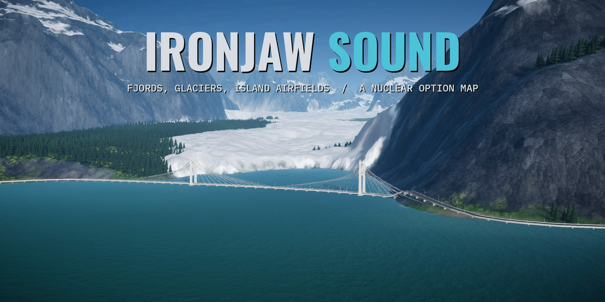
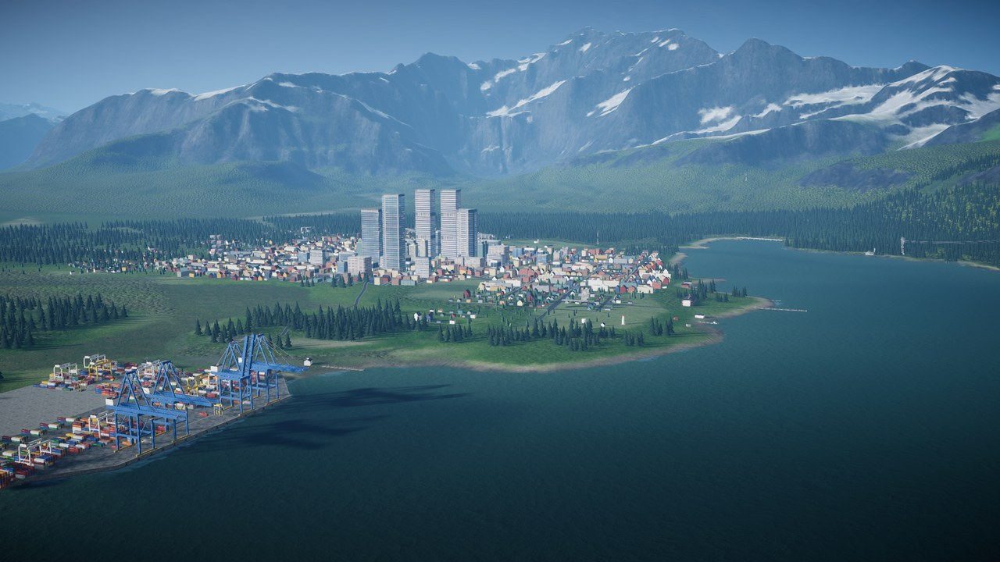
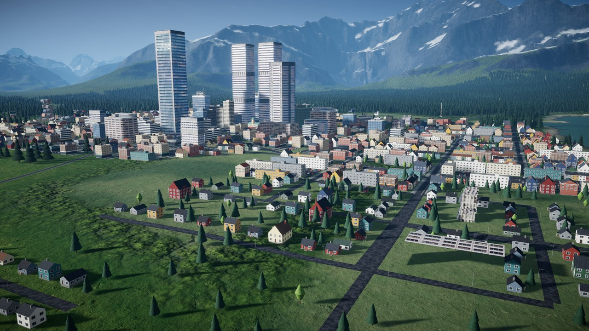
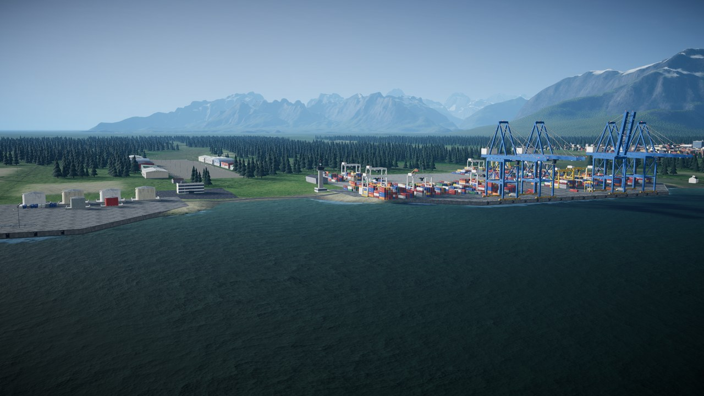
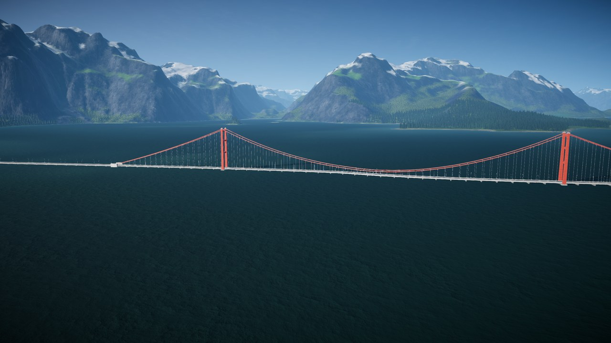
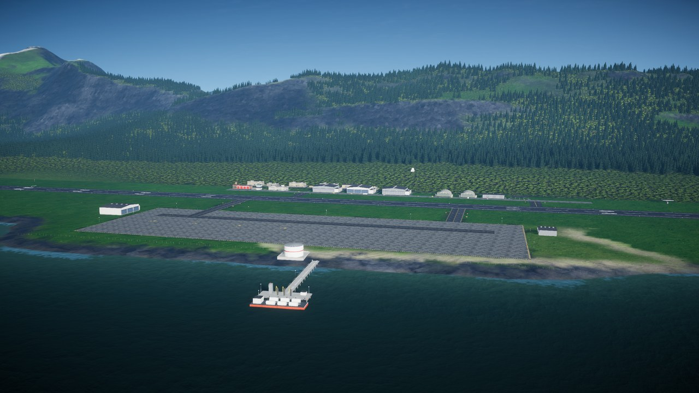
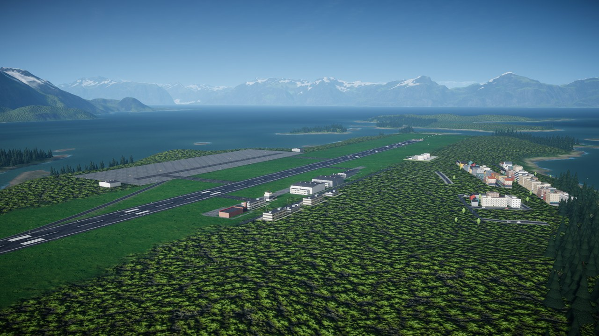
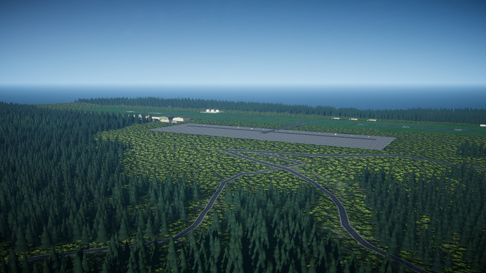
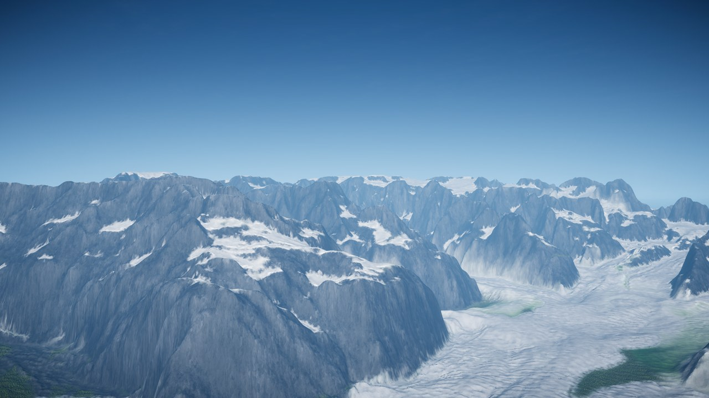
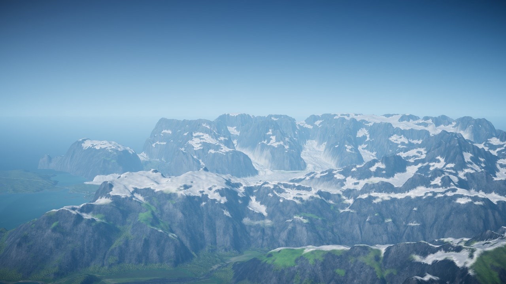

<p align="center">
  
</p>

<p align="center">
  <picture>
    <source media="(prefers-color-scheme: dark)" srcset="docs/media/logo-dark.png">
    
  </picture>
</p>

<p align="center">
  <b>A new map for Nuclear Option: an 82 km square of fjords, glaciers and island airfields, with 15 missions.</b>
</p>

<p align="center">
  
</p>

Ironjaw Sound is a free map for [Nuclear Option](https://store.steampowered.com/app/2168680/). It is
fan-made and not affiliated with Shockfront Studios.

**Status: 1.0.0, the first packaged release.** Made for Nuclear Option 0.34.1 (Steam build 24724372).
All 15 missions were loaded from the release zip in a clean copy of the game and ran for three minutes
each, with no warnings or errors in the log. Earlier builds were played online by two players, one of
them on Windows. 1.0.0 itself has only been tested on Linux so far. Please report what you see.

## What is on the map

Ironjaw Sound is fictional. Its shape comes from real elevation and sea-floor data of Prince William
Sound in Alaska, squeezed down so the mountains stay under the game's height limit, then edited and
renamed.

- **Water everywhere.** A big sound in the south, long fjords running into the mountains, the Ironjaw
  Narrows, Tarn Bay, Graylock Fjord and an island chain across the east.
- **Mountains and ice.** The highest peaks reach about 1,900 m, with snowfields and glaciers coming
  down the valleys. The Glacier Run race flies over them.
- **Snow spruce forest** on the lower slopes, and rocks and boulders on the high ground.
- **Seven runways.** Sorrel Field, Rook Island NAS, Fenwick Field, Ostrin Isles Strip, Tarn Head Strip,
  Graylock Strip and Graylock South Strip. Each has an apron, taxiways, hangars and lights. The
  shortest runway is 1.8 km, so every jet in the game can use every runway.
- **Seven helicopter bases and landing zones.** Kittiwake, Delta Gate, Cinder Gate and Brekka Hills
  FARPs, and the Dunmore Crossing, Hollin Mine and Skerry Island landing zones.
- **Towns and a port.** Port Ansel has a harbour, cranes and a town centre. Smaller towns sit along the
  roads.
- **Roads and bridges.** A road network ties the bases together, with a 2.3 km bridge across Halvard
  Sound. There are also power lines, wind turbines and a lighthouse on the Port Ansel headland.

| | |
|---|---|
|  |  |
| Port Ansel from 500 m. | The container harbour at Port Ansel. |
|  |  |
| The Halvard Sound bridge. | Rook Island NAS and its fuel pier. |
|  |  |
| Fenwick Field. | Graylock Strip, deep in the forest. |
|  |  |
| The high peaks and a glacier. | Snowfields above the fjords. |

## Missions

The release comes with 15 missions. They all work in single player and multiplayer, and they show up
in the game's mission list as "Ironjaw Sound - ...".

| Mission | What it is |
|---|---|
| **Escalation** | The whole map at war, built like the stock Escalation. Factories, armour columns, five neutral landing zones, nuclear weapons late in the match. |
| **Fjord Confrontation** | A combined-arms war across the Cinder Range, built like the stock Confrontation. |
| **Supply Line** | Fjord Confrontation with a supply war: carry crates under a helicopter to capture sites and build forward supply dumps. |
| **Ostrin Confrontation** | A Confrontation-style war over the east half of the map, with a Boscali carrier group. |
| **Island Hop** | A helicopter-heavy fight for Fenwick, the Ostrin Isles and Skerry Island. |
| **Sill Strike** | A small strike up Graylock Fjord from a carrier at its mouth. |
| **Tarn Head Raid** | Both sides push for the other's main airbase. |
| **Tarn Bay Strike** | Sink the Primeva warships in Tarn Bay and the Narrows. |
| **SAM Hunt** | Destroy every long-range SAM radar in the fjords within an hour. |
| **Port Ansel Defence** | Stop an amphibious fleet before it burns the port's fuel tanks. |
| **Gannet Sound Defence** | Sink a carrier group and landing force before it takes Rook Island. |
| **Free Flight** | Every base open, unlimited funds, no AI aircraft. Good for a first look. |
| **Air Race Fjord Sprint** | 41 km and 26 gates, low over the water. About 3 minutes in a fast jet. |
| **Air Race Glacier Run** | 41 km and 22 gates over the ice and The Col. About 3 minutes. |
| **Air Race Grand Tour** | The whole map: 128 km and 43 gates. About 9 minutes. |

**Air races.** The host runs the race from the chat: `!race grid` opens the start grid in the air,
`!race go` starts the race, `!race reset` starts over and `!race status` shows where everyone is. You
get gate rings, a timer, split times and a results board.

## Install

You need Nuclear Option from Steam. Close the game first.

### With NOMM

Install **Ironjaw Sound** in [NOMM](https://github.com/KopterBuzz/NOMM), the Nuclear Option mod
manager. NOMM installs BepInEx and NOMapLoader for you. Start the game.

### By hand

1. Install [BepInEx 5.4.23.5](https://github.com/BepInEx/BepInEx/releases/tag/v5.4.23.5) (the x64
   version for Windows) into your Nuclear Option folder, if it is not there yet. Start the game once and
   close it, so BepInEx makes its folders. On Linux, also set this Steam launch option for the game:
   `WINEDLLOVERRIDES="winhttp=n,b" %command%`
2. Download `NOMapLoader_1.0.5.dll` from
   [NOMapLoader's releases](https://github.com/MinecrackTyler/NOMapLoader/releases/tag/v1.0.5) and put
   it in `BepInEx/plugins/NOMapLoader/`.
3. Download `IronjawSound-1.0.0.zip` from
   [Releases](https://github.com/Talamander/ironjaw-sound/releases).
4. Make the folder `BepInEx/plugins/IronjawSound/` and unzip the whole zip into it. The DLLs and
   `map_ironjawsound` go directly in that folder, not in a subfolder.
5. Start the game. Pick a mission called "Ironjaw Sound - ..." from the mission list, or pick Ironjaw
   Sound in the Mission Editor.

To find your Nuclear Option folder: in Steam, right-click Nuclear Option, then **Manage**, then
**Browse local files**.

To check that it loaded, open `BepInEx/LogOutput.log` in your Nuclear Option folder. It should have the
line `Ironjaw Sound 1.0.0 (2026-10-13), 52 files present with the expected sizes.`

### Updating from v9

v9 put its files in four folders. 1.0.0 lives in one. Delete these first, then install as above:

- `BepInEx/plugins/NOMapLoader/map_ironjawsound` (keep `NOMapLoader_1.0.5.dll`)
- `BepInEx/plugins/TerrainLabGameplay/`, `TerrainLabNOPatch/`, `TerrainLabScatter/` and
  `TerrainLabRace/` if you have it
- `BepInEx/config/talamander.terrainlab.*.cfg` (the old settings had debug logging on)

If you forget, the log says which old files are still there. Your old "Ironjaw Sound - ..." missions
are updated on the first start, unless you edited them.

### Updates

NOMM shows new versions and installs them for you. By hand, delete `BepInEx/plugins/IronjawSound/` and
unzip the new zip in its place. Every change is listed in [CHANGELOG.md](CHANGELOG.md).

## Check your download

Each release has `SHA256SUMS`, `SHA256SUMS.sig` and `allowed_signers` next to the zip. The signature
shows that the zip is the one I built and that nobody changed it on the way. You do not need to do this to play.

Put the four files in one folder and open a terminal there.

On Windows (PowerShell):

```powershell
Get-FileHash IronjawSound-1.0.0.zip -Algorithm SHA256
cmd /c "ssh-keygen -Y verify -f allowed_signers -I ironjaw-sound-release -n file -s SHA256SUMS.sig < SHA256SUMS"
```

On Linux:

```sh
sha256sum -c SHA256SUMS
ssh-keygen -Y verify -f allowed_signers -I ironjaw-sound-release -n file -s SHA256SUMS.sig < SHA256SUMS
```

The hash must match the line in `SHA256SUMS`, and the last command must print:

```text
Good "file" signature for ironjaw-sound-release with ED25519 key SHA256:CQyIGTBz+aBQZyUJLL7gJOx5/pK+q500i8x5azawxJg
```

Do not trust only the `allowed_signers` file that came with the download. Compare its key with the one
below, which is also in [allowed_signers](allowed_signers) in this repository. Every release is signed
with this same key.

```text
ironjaw-sound-release namespaces="file" ssh-ed25519 AAAAC3NzaC1lZDI1NTE5AAAAII4OZ8DmNVhzP7EPVslHzXByuT8av5M3D1/FrzOJpP48
```

## Uninstall

Close the game first.

- The map: delete `BepInEx/plugins/IronjawSound/`.
- Its settings: delete `BepInEx/config/talamander.terrainlab.*.cfg` and
  `BepInEx/config/talamander.terrainlab.missions.state`.
- The missions: they stay in your mission folder. Delete the "Ironjaw Sound - ..." folders there if
  you want them gone. On Windows the folder is
  `%USERPROFILE%\AppData\LocalLow\Shockfront\NuclearOption\Missions`.
- NOMapLoader and BepInEx: delete them only if no other mod needs them.

## Questions and limits

**Do other players need it?**
Yes. Everyone in a multiplayer game needs the same version of Ironjaw Sound, NOMapLoader and BepInEx.
Players who join do not need the mission files, because the host sends the mission.

**Does it change the stock maps?**
No. The plugins check which map is loaded and do nothing on Heartland, Ignus or other custom maps.

**Where do the missions come from?**
On start, the map copies its missions into the game's mission folder. If a mission from an earlier
release is there, it is updated. If you edited a mission, your copy is kept and the log says so. Your
own missions are never touched. To turn the copying off, set `InstallMissions = false` in
`BepInEx/config/talamander.terrainlab.gameplay.cfg`.

**How big is it?**
The download is 419 MB and it takes 489 MB on disk. Almost all of that is the map itself (terrain,
textures and the shaders the game needs on every graphics card).

**Are the buildings from the game?**
Many are. The houses, apartment and office blocks, industrial sheds, wind turbines and power pylons are
copies of the game's own buildings. The map makes them from your installed game when it loads, so nothing
from the game is in the download. The airfield buildings, the harbour, the bridges and the lighthouse
were made for this map.

**Something does not work.**
Open an issue on [GitHub](https://github.com/Talamander/ironjaw-sound/issues). Say what you did and
what went wrong, and attach `BepInEx/LogOutput.log` from your Nuclear Option folder. Attach it right
after the problem, before you start the game again, because the game rewrites it on every start.

## Known issues

- Nuclear strikes do not leave the blackened ground on Ironjaw Sound that they leave on the stock maps.
- In Fjord Confrontation, Supply Line and Escalation, Primeva's armour starts at the Cinder Gate depot,
  which sits in a closed mountain basin. It has to drive about 30 km of road to reach Dunmore Crossing, so
  it arrives late. The depot may move in a later release.
- The track out of that basin is a rough mountain track, up to 34% steep in places. Vehicles get through,
  but slowly. It may be graded in a later release.
- 1.0.0 has not been played in multiplayer or on Windows yet. Earlier builds have been.

## More mods

- [Nuclear Replay](https://github.com/Talamander/nuclear-replay): record your matches and watch them
  back from any angle.
- [Missile Cam](https://github.com/Talamander/no-missile-cam): follow your own missiles in flight with the
  camera, and look at your selected target.
- [Nuke Aftermath](https://github.com/Talamander/no-nuke-aftermath): nuclear strikes get a bigger blast,
  and leave burnt ground, fallen forest and fires behind.

## Credits and license

Made by Talamander: terrain, textures, trees, rocks, roads, airfields, missions and the four plugins.

- The terrain is shaped from public-domain data: the U.S. Geological Survey 3D Elevation Program and
  NOAA National Centers for Environmental Information coastal elevation models. The full list is in
  [THIRD-PARTY-NOTICES.md](THIRD-PARTY-NOTICES.md). It is not a real-world map and must not be used for
  navigation.
- [NOMapLoader](https://github.com/MinecrackTyler/NOMapLoader) by MinecrackTyler loads the map. It is
  not included; download it from its own page, or let NOMM install it.
- [BepInEx](https://github.com/BepInEx/BepInEx) by the BepInEx team.

Ironjaw Sound is a fan-made map. It is not made, supported or endorsed by Shockfront Studios, the makers
of Nuclear Option.

Ironjaw Sound is released under the [MIT license](LICENSE). The map bundle contains compiled Unity
shaders, which are covered by the Unity Companion License.

## For developers

The source of the four plugins is in [plugins/](plugins). How to build them and how releases are made
and signed is in [docs/DEVELOPMENT.md](docs/DEVELOPMENT.md).
